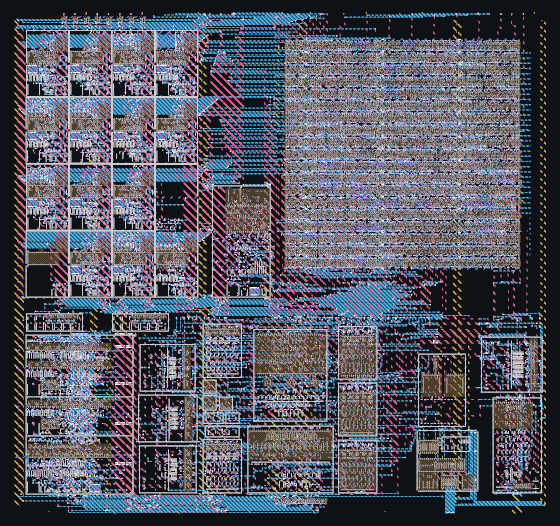

<!---
This file is used to generate the project datasheet (Tiny Tapeout). Images must be < 512 kB each, < 1 MB total.
-->

## How it works

The **Analog Neuron Test Bench** is a mixed-signal neuromorphic test chip on an analog 1 × 2 tile (gf180mcuD, 3.3 V).
It integrates 16 analog spiking neurons, a bit-exact digital LIF reference neuron, a programmable bias generator and a
buffered probe readout. The goal is to measure effects that simulation does not capture well — device mismatch and its
spatial gradients, drift, hold-node leakage, noise, real parasitic capacitance and temperature — against a software
reference model, and to measure what per-neuron configurability buys in accuracy.

### Blocks

| Block | Description |
|---|---|
| Neuron array (4 × 4 slots) | Axon-hillock LIF neurons with a 200 fF membrane, leak OTA, refractory period, two input synapses (stimulus A and B), hold switch, membrane reset and an in-cell probe follower. Four groups (M2: two rows of trimmed slots, two compact rows): **S** (shared biases, ×3), **F** (leak set by geometry, τ_F = 2 τ_S, ×3), **H** (shared biases plus a 4-bit threshold trim, ×3) and **P** (threshold trim plus a 4-bit leak-τ trim, ×2). Single variants: **CMP** (comparator-based LIF with a threshold trim, double-height slot), **AH50** and **AH400** (50 fF and ~470 fF membranes) and **REF** (probe of the resting-potential line, for calibration). |
| AdEx (channel 3) | Adaptive exponential integrate-and-fire neuron with a programmable adaptation current (`vbp_w`). |
| D1 dendrite (channel 13) | Soma plus two dendritic subunits with an all-or-none plateau nonlinearity. Star or chain topology; clustered or distributed stimulus. |
| Digital LIF | 12-bit bit-serial LIF in the control block. It is clocked by `clk` and performs one update per `ui[7]` tick, reproducing the software model exactly. |
| B1 bias generator | Takes its reference current from `ua[0]` or an internal reference. Five 5-bit current DACs, three 5-bit voltage DACs and a 6-bit threshold DAC. The `ua[0]` current sets the operating speed, S = 10–1000× biological real time. |
| R1 readout | Buffers one selected node (membrane, adaptation or dendrite) onto `ua[1]` with a 400 µA source follower. It also holds the reset-voltage and detector-rail buffers. |
| Control block | Synthesized digital macro: 3-wire configuration port, 23 bytes of write-only latches, probe decoder and the digital LIF. |

All 16 spike outputs are plain digital levels on `uo[7:0]` and `uio[7:0]`. Spike timing and counting, stimulus
sequencing and the LIF tick are handled off-chip by the demo board's RP2040/RP2350 (PIO).

## Pinout

| Pin | Function |
|---|---|
| ui[0] | CFG_SCK: configuration shift clock (rising edge) |
| ui[1] | CFG_DATA: configuration serial data, MSB first |
| ui[2] | CFG_LOAD: configuration latch strobe (high = write) |
| ui[3] | Stimulus A (`rt_out[0]`); digital-LIF event source 0 |
| ui[4] | Stimulus B (`rt_out[1]`); digital-LIF event source 1 |
| ui[5] | Hold (`rt_out[2]`) |
| ui[6] | Membrane reset (`rt_out[3]`) |
| ui[7] | Digital-LIF tick (one update per rising edge) |
| uo[7:0] | Spikes of analog channels 0–7 |
| uio[5:0] | Spikes of analog channels 8–13 |
| uio[6] | OUT_MUX = 0: digital-LIF spike; OUT_MUX = 1: channel 14 |
| uio[7] | OUT_MUX = 0: configuration echo (shift-register MSB); OUT_MUX = 1: channel 15 |
| ua[0] | Bias reference current input (EXT ÷1 or ÷16), stimulus input, or internal-reference monitor |
| ua[1] | Buffered analog probe output |

All `uio` pins are outputs (`uio_oe` tied high). `uio_in`, `ena` and `ua[2..5]` are not used.

**Spike channels**

| Channel | Neuron | Channel | Neuron |
|---|---|---|---|
| 0, 4, 8 | S1, S2, S3 | 7, 11 | P2, P3 |
| 1, 5, 9 | F1, F2, F3 | 12 | CMP |
| 2, 6, 10 | H1, H2, H3 | 13 | D1 |
| 3 | AdEx | 14, 15 | AH50, AH400 |

**Probe select:** PROBE SEL equals the spike channel for every neuron except two. SEL = 4 shows CMP's membrane and
SEL = 12 shows S2's (CMP and S2 swapped array positions after the control block was frozen).

## Register map (summary)

The full map, timing and bit packing are in [`docs/regmap.md`](regmap.md).

- **Write protocol:** shift a 13-bit frame `{ADDR[4:0], DATA[7:0]}` MSB first on SCK/DATA, then pulse LOAD high
  for at least 50 ns. Only the last 13 bits before LOAD count. There is no read-back. With OUT_MUX = 0, `uio[7]`
  echoes the shift register 13 SCK edges later as a link check. The port works with `clk` stopped. `rst_n` low clears
  every byte to 0, which turns everything off.

| Address | Name | Contents |
|---|---|---|
| 0x00–0x04 | IDAC | Eight 5-bit DAC codes (leak, refractory, synapse, D1 axial, AdEx adaptation, EL, V_reset, CMP threshold), packed as a 40-bit word, LSB first |
| 0x05 | VDAC | 6-bit threshold reference `vth_ref` |
| 0x06 | ANA | Group enables, D1 plateau / chain / stimulus-B steering, BIAS_EN |
| 0x07 | PROBE | SEL (channel to probe; see the note above), SUB (membrane / secondary node / REF; the compact slots S, F, AH50 and AH400 have no secondary-node tap), PROBE_EN |
| 0x08 | MODE | `ua[0]` mode, OUT_MUX, IB_X2 (readout bias ×2), RT_EN (enables for the `ui[6:3]` pass-throughs) |
| 0x09–0x0E | LIF | Digital LIF: enable and source, leak shift and refractory, EL, Vth, Vreset, weight |
| 0x0F–0x16 | TRIM | 4-bit trims: H/P/CMP thresholds, D1 plateau thresholds, P leak-τ |

**P leak-τ trim.** Code c (nibbles 14 and 15) sets that P neuron's leak current to (8 + c)/16 of the S neurons' at the
same leak DAC code, so τ_P ≈ τ_S · 16/(8 + c). Code 8 gives τ_S, code 0 gives 2 τ_S, and code 15 gives 0.7 τ_S. On
hot, fast silicon, keep the leak current above about 30 pA per neuron, or the range compresses.

## How to test

**Setup:** the demo board's RP2040/RP2350 drives `ui[2:0]`. A 0.1–10 µA current source or SMU drives `ua[0]`, and an
oscilloscope or ADC reads `ua[1]`.

1. Select the project, then pulse `rst_n` low. Everything starts off: all codes 0, BIAS_EN = 0, probe disabled.
2. **Link check:** with OUT_MUX = 0, shift a known pattern and confirm it returns on `uio[7]` 13 SCK edges later.
3. **Set the speed:** apply the reference current to `ua[0]`. In EXT ÷1 mode, S = 100 × I (µA): 0.1, 1 and 10 µA give
   S = 10, 100 and 1000. EXT ÷16 mode needs 16× the current for the same S. The internal reference (UA0_MODE 2 or 3)
   gives S ≈ 100 without an external source.
4. **Program the biases:** with BIAS_EN = 0, write the DAC codes (IDAC, VDAC), then set BIAS_EN = 1.
5. **Calibrate** per die and per speed setting:
   1. probe REF (PROBE_SUB = 3) to measure EL;
   2. set the threshold code using the REF channel and firing-rate checks;
   3. set EL;
   4. set the H, P, CMP and D1 trims;
   5. **leak code at high speed (S ≥ ~1000):** scale the `vbn_leak` code with S, then correct it so that the
      large-signal behaviour scales, not the small-signal one. Measure the rheobase of an S neuron (the smallest
      stimulus that makes it fire) at S = 100, then at the target S, and adjust the leak code until
      rheo(S) / ((S / 100) · rheo(100)) ≈ 1. Post-layout simulation gives the nominal code × 13/12 at tt, ss and ff
      (ratio 1.03 / 0.98 / 1.03). Do **not** match the leak conductance at rest (the small-signal τ at EL): at ss / 0 °C
      that over-corrects (code 21: no firing at 1.1 × rheobase). Repeat after a large temperature change.
6. **Run the analog neurons:** set RT_EN, drive stimulus A/B on `ui[3]`/`ui[4]` and count spikes on `uo`/`uio`. Move the
   probe to observe membranes on `ua[1]`.
7. **Run the digital LIF:** write the LIF parameters with LIF_EN = 0, then set LIF_EN = 1. Drive `clk` and tick `ui[7]`,
   at least 48 clock cycles apart.

### Firmware rules

- **Rewrite the whole configuration after every project enable.** The design is unpowered while deselected.
- **Change the probe in three steps:** disable it (PROBE_EN = 0 with the old SEL/SUB), change SEL/SUB, then re-enable.
  Wait at least 2.5 µs after re-enabling before sampling `ua[1]` (post-layout 1 % settling into 200 pF: 2.0 µs
  typical, 2.05 µs at ss / 0 °C).
  Enabling or disabling the D1 probe kicks D1's compartments by up to +6 / −8 mV (post-layout, ss / 0 °C; the
  two edges nearly cancel). Switch the D1 probe while D1 is at rest, not mid-measurement.
- **Hold BIAS_EN = 0 while changing bias codes**, because a 5-bit code can straddle two bytes.
- **Change digital-LIF parameters only while LIF_EN = 0**, and wait at least 3 clock cycles after clearing it.
- **Stop `clk` during analog measurements.** The configuration latches, spike outputs and stimulus pass-throughs work
  without it.
- **Pulse MRESET after setting BIAS_EN** to clear the AdEx adaptation node, which powers up near VDD.
- **Wait for the leak line to settle** after a leak-code change: up to about 10 ms at S = 10.
- **Speed range:** S = 10–1000 is fully supported; S = 10000 with the limits below.
  - At S ≥ ~300, use EL / Vth / Vreset ≈ 1.50 / 1.58 / 1.50 V so the leak OTA has enough headroom at every corner.
  - From S = 1000 up to about 2000: stimulate at most ~4 array neurons at once, set IB_X2 and use the ÷1 `ua[0]` mode.
  - S = 10000 (M2 cells, level 3 + 4): use EL / Vreset 1.50 V and the high-speed leak-code rule (step 5.5). Every slot
    type passes the post-layout f–I gate (0.7–1.4 × ideal scaling) at tt / ss / ff, including ss / 0 °C. Limits: the
    CMP slot needs the vth_cmp code window below; AH50 needs the step 5.5 leak calibration at ss / 0 °C (1.38 of 1.4
    uncalibrated, 1.29 calibrated). Full chip (post-layout, tt / 27 °C and ss / 0 °C, 100 µA into `ua[0]` in EXT ÷1
    mode, IB_X2, leak code ×13/12, all 13 array neurons and AdEx firing at 2–4 × rheobase): every neuron fires, with no
    false CMP spikes at codes 26 and 27. Firing moves the bias lines by ≤ 6 mV (mean); local p-p ripple is up to
    ~100 mV on vreset and ~60 mV on vsrc. Supply current is 0.70–0.85 mA (peak 1.4 mA). Static IR drop is ≤ 9 mV with the PDN fed at both stripe ends (B1 / R1), ≤ 15 mV fed from the top only.
  - **CMP threshold code (vth_cmp, IDAC code 8 = r2, word bits 35–39 = byte 0x04 bits 3–7):** vth_cmp ≈
    1.225 V + 13.7 mV × code (M3 DAC, 1.23–1.64 V). At S = 10000 only **codes 26 and 27** pass the f–I gate at every
    corner (post-layout slot_cmp_h, EL 1.50 V; min–max of f/f_ideal, pass 0.7–1.4):

    | code | vth_cmp | tt / 27 °C | ss / 0 °C | ff / 85 °C |
    |---|---|---|---|---|
    | 25 | ~1.567 V | 0.69–0.86 fail | 0.68–0.88 fail | 0.57–0.81 fail |
    | 26 | ~1.580 V | 0.78–0.92 | 0.75–0.95 (calibrated leak 0.75–0.88) | 0.80–0.92 |
    | 27 | ~1.594 V | 0.81–0.99 | 0.79–1.09 | 0.84–0.94 |
    | 28 | ~1.608 V | 0.84–1.52 fail | no firing at 1.1 × rheobase | 0.86–0.99 |

    Too low a code makes the CMP too slow at high drive (the comparator's trip falls with speed); too high a code stops
    it firing near rheobase. Use **26** as the starting code at S = 10000 (it passes on more dies under mismatch, see below). At S ≤ ~1000 set vth_cmp ≈ Vth:
    code ≈ (Vth − 1.225 V) / 13.7 mV, e.g. 11 for 1.38 V, 26 for 1.58 V. Per die: with BIAS_EN = 0 write r2, set BIAS_EN = 1, drive
    the CMP slot at 1.1 × and 8 × its rheobase, and compare the rates with the same run at S = 100. If 1.1 × fires too
    fast or not at all, step r2 down by one; if 8 × is below ~0.75 × ideal scaling, step r2 up by one. Re-check after
    the leak calibration (step 5.5), which moves the 1.1 × point.
    **The per-die step is required at S = 10000.** A mismatch Monte Carlo (vth_cmp DAC offset σ ≈ 13 mV, about one
    code, plus slot mismatch; 40 dies over tt / ss / ff) shows that no fixed code passes on every die. At ss / 0 °C,
    code 27 passes on 65 % of dies and code 26 on 80 %; either 26 or 27 passes on 95 %. The window moves by up to ±1
    code, so some dies need 25 or 28 (1 of 20 dies needed 28 at ss); every simulated die passed at some code in 25–28.
    Start from 26, follow the step rule above, and allow codes 25–28.

## External hardware

- A precision current source or SMU sourcing current into `ua[0]` (the pad sits at about 0.5–0.75 V): 0.1–10 µA in ÷1
  mode or 1.6–160 µA in ÷16 mode.
- An oscilloscope or ADC on `ua[1]` (0.5–2.3 V output; up to about 2 µs settling into 200 pF).
- The Tiny Tapeout demo board's RP2040/RP2350 for configuration, stimulus timing and spike capture (PIO).
