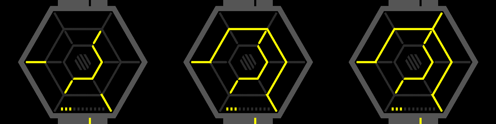
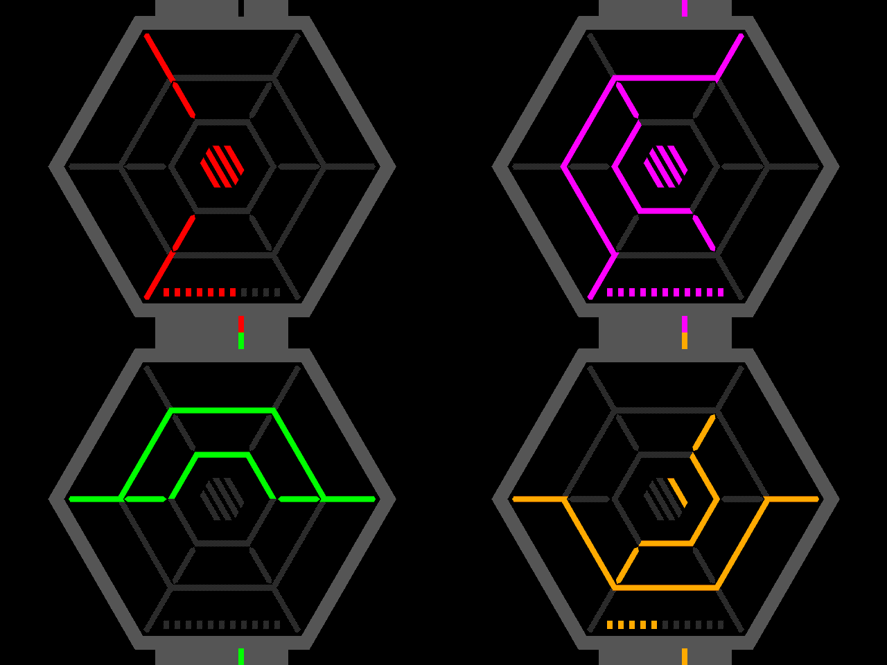
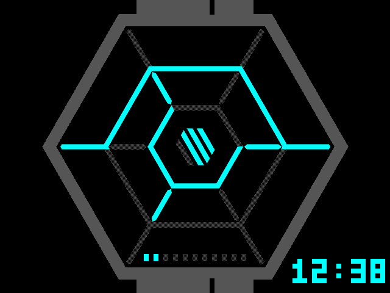
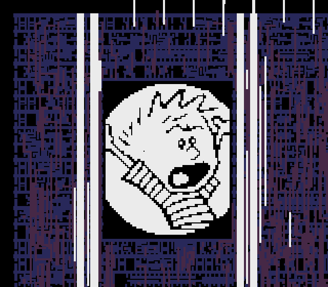

## How it works

Glyph is a clock and calendar on a VGA monitor (640x480 at 60 Hz) that tells
the time using a "Glyph" cryptic format.  This was inspired by a watch
design concept I saw on a "Tokyoflash" website in 2014.  It uses lit "LED" segments on
a web of concentric hexagons instead of hands or digits.

The original concept page is here: 
    https://blog.tokyoflash.com/2014/04/29/glyph-led-watch-looks-cryptic-is-actually-easy/

### Reading the face

The hexagon has corners at 3 and 9 o'clock, so the odd hours sit on its six
corners and the even hours on its six flat sides. There are two rings:

- the **outer ring** (outer spokes and the large hexagon) shows the **hour**;
- the **inner ring** (inner spokes and the small hexagon) shows the
  **minutes in steps of five**, with 00 at the top, 05 where the 1 is, and so on;
- the four **stripes in the center** add 1 to 4 single minutes.

The lit lines copy the edges of the watch nearest the number:

- a number on a **flat side** lights a bracket of three hexagon edges bulging
  toward it, ending in the two spokes three hours either side
  (12 lights the edges at 10, 12 and 2 and the spokes at 9 and 3);
- a number on a **corner** lights the two spokes four hours either side of it,
  which are parallel to the two edges that meet at that corner
  (1 lights the spokes at 9 and 5; 3 lights 11 and 7).

The mode pins make the corner numbers easier:

| Mode | A number on a corner shows |
|---|---|
| Hard | the two spokes only |
| Medium | the two spokes joined round the hexagon, through the corner |
| Easy | the same, plus the spoke at the corner itself, pointing at the number |

The strap carries two bars: the **top bar is lit from noon to midnight** (PM),
and the **bottom bar blinks** once a second.

The time can also be written **in digits** in the lower right corner (12 hour,
in a 3x5 font), for checking your reading in any mode. They are on after
reset; button B while `ui[2]` is high turns them off and on. In the date view
the digits are the date, month first: `7/23` is 23 July.

A row of eleven **5-second ticks along the bottom of the face**, between the
5 and 7 o'clock spokes, counts the seconds in fives: the first lights at 5
seconds, the second at 10, and so on to 55, and all go out when the minute
turns. Unlit ticks are dim with the grid on (`ui[3]` low) and invisible with
it off.

With **Show date** high the same face shows the date: the outer ring is the
month (1 to 12) and the inner ring and stripes are the day, read like minutes
(the 23rd is the "20" position and three stripes). After reset, and whenever
the view changes, the face draws itself on line by line.

### Inside

Every pixel is classified from three signed distances to the screen center
(vertical, and the two axes 60 degrees either side), each of which is both
the distance to a pair of hexagon edges and the perpendicular distance to a
pair of spokes. The largest of the three is the pixel's hexagonal radius;
rings are bands of that radius and spokes are bands around zero of the
others, so no multiplier and no line drawing are needed, and the fraction of
a pixel left at a band's edge anti-aliases the lines with the four levels the
2 bit DAC has. The time is stored the way it is shown (hours 0 to 11 and
AM/PM, minutes as fives and ones), so the display needs no division.

The seconds are counted from the pixel clock: 25.175 MHz gives exact
seconds; at 25.000 MHz the clock loses 0.7 percent. February always has 28
days.

### Chip art

While you can't see it, I put my "Calvin" avatar image in Metal4 in the bottom
left of the tile, between the first two
pairs of power stripes (30.0 x 36.5 um, 0.5 um pixels). The ten rows of
standard cells under him are cut out and the router is kept off the patch on
every layer, so there is nothing beneath the picture.  At least it is visible
in the 3D GDS Viewer that way.

## How to test

Connect a Tiny VGA PMOD to the output port and a 25.175 MHz clock. After
reset the face draws on and shows 12:00 AM, 1 January.

| Pin | Function |
|---|---|
| `ui[0]` | Button A: Hour + in the time view, Month + in the date view; Color + while `ui[2]` is high |
| `ui[1]` | Button B: Minute + in the time view (also zeroes the seconds), Day + in the date view; digits on/off while `ui[2]` is high |
| `ui[2]` | The buttons set the display instead of the clock: A steps the LED color, B turns the digits on and off |
| `ui[3]` | Grid off: low draws the unlit segments dimly; high shows only the lit ones and the watch body |
| `ui[4]` | Show the date instead of the time |
| `ui[6:5]` | Mode: 00 hard, 01 medium, 1x easy |
| `ui[7]` | Fast: the clock runs 900 times faster, a minute every 4 frames |

The inputs are sampled once per frame (60 times a second), which debounces
them: hold a level for at least two frames (about 35 ms) for it to be seen.
A press advances its field by one; holding a button repeats after half a
second, then about 7 times a second.

### How to set the time

1. Set `ui[4]` low (time view) and `ui[2]` low.
2. Press `ui[0]` to advance the hour. It runs 12, 1, 2 ... 11 and the top
   strap bar (PM) toggles each time it passes 12.
3. Press `ui[1]` to advance the minute. Each press also zeroes the seconds,
   so the last press starts the minute.

Setting a field never carries into the next one: stepping the minute from 59
to 00 does not change the hour.

To start from a known time, hold `ui[0]` and `ui[1]` high together: the time
goes back to 12:00:00 AM and stays there until they are released. The date,
color and everything else are untouched. A host can set any time by
clearing and then counting presses: 3:27 PM is a clear, 15 presses of
`ui[0]` and 27 of `ui[1]`.

### How to set the date

1. Set `ui[4]` high (date view) and `ui[2]` low.
2. Press `ui[0]` to advance the month, January to December and round again.
3. Press `ui[1]` to advance the day. It wraps to 1 after the last day of the
   month shown (February always has 28).

If the month changes to one that does not have the day shown, the day drops
to the last day of the new month, so set the month first.

`ui[0]` and `ui[1]` held together in the date view put the date back to
1 January and leave the time alone.

### How to change the color

1. Set `ui[2]` high.
2. Press `ui[0]`. Each press steps the color of the lit segments: yellow
   (after reset), red, green, blue, magenta, cyan, amber, white, and back to
   yellow.
3. Set `ui[2]` low again, or `ui[0]` will not set the hour or month.

This works in either view and does not change the time or date.

### How to turn the numeric display off and on

1. Set `ui[2]` high.
2. Press `ui[1]`. Each press turns the digits in the lower right corner on
   off or on. They are on after reset.
3. Set `ui[2]` low again.

The digits follow the view: the time as `12:38` (12 hour; the top strap bar
is PM) with `ui[4]` low, the date as month/day, `7/23`, with `ui[4]` high.
They work in hard, medium and easy mode.

### How to read out the date and time on uio

`uio[6:4]` are inputs that select a number and `uio[3:0]` are outputs that
carry it, so a host that set the clock can check it. `uio[7]` is not used.

| `uio[6:4]` | `uio[3:0]` |
|---|---|
| 0 | hour, 0 to 11 (0 is twelve) |
| 1 | 1 from noon to midnight (PM), otherwise 0 |
| 2 | minutes / 5, 0 to 11 |
| 3 | minutes mod 5, 0 to 4 |
| 4 | month, 1 to 11 (0 is December) |
| 5 | day / 5, 0 to 6 |
| 6 | day mod 5, 0 to 4 |
| 7 | seconds / 5, 0 to 11 |

The clock keeps the minute and the day in the two parts the face shows, so
the host puts them together:

- hour (24 hour) = (select 0) + 12 x (select 1)
- minute = 5 x (select 2) + (select 3)
- month = (select 4), or 12 if it reads 0
- day = 5 x (select 5) + (select 6)

The value follows a change of the select within two clocks. The numbers
themselves change only once per frame, at the start of vertical blanking; a
host reading several of them as the minute turns can read each twice, or
read during the picture, to be sure they belong together. The readout does
not depend on the view or on any other input.

## External hardware

[Tiny VGA PMOD](https://github.com/mole99/tiny-vga) on the output port, and a
VGA monitor.
