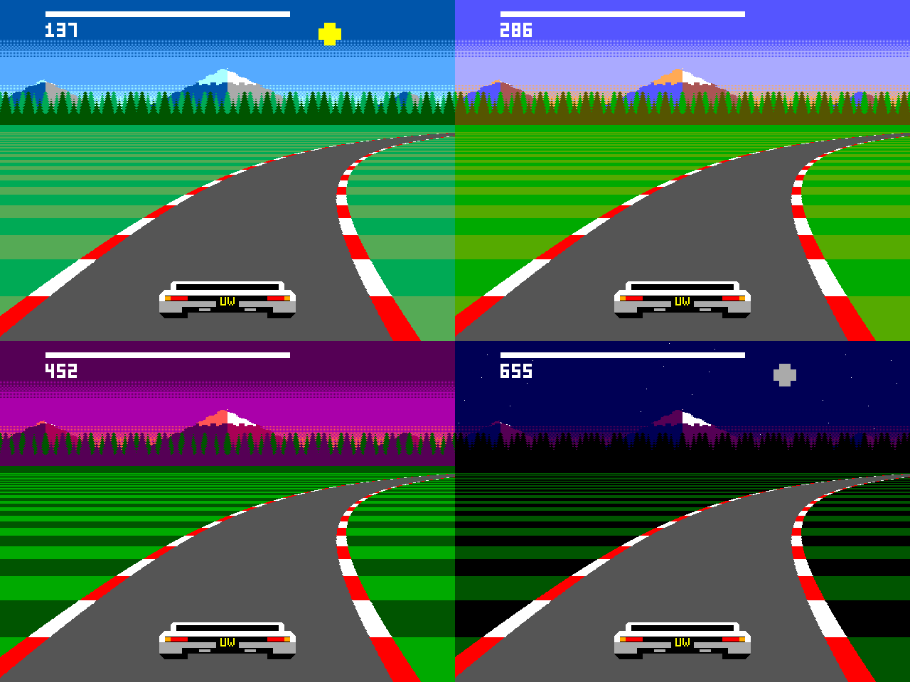

<!---

This file is used to generate your project datasheet. Please fill in the information below and delete any unused
sections.

You can also include images in this folder and reference them in the markdown. Each image must be less than
512 kb in size, and the combined size of all images must be less than 1 MB.
-->

# How it works

Tiny Driver is a pseudo 3D racing game inspired by Atari's 1976 Night Driver, you drive down an endless winding road against a 60 second clock, and every 200 points buys 20 more seconds and moves the day on toward night where the roads continually turn tighter as your score rises. Veering off costs you a time penalty, so stay on the road. The goal is in the title of the original, drive until it's night!

The chip drives a VGA monitor directly (640 × 480 at 60 Hz, 64 colours) through the TinyVGA Pmod,
reads five buttons or the Gamepad Pmod, and plays 1-bit sound effects. The ASIC holds about 70 bits of game state and works out the colour of every pixel at the moment the monitor asks for it. The road, kerbs, grass, mountains, trees, sun, car and score are all comparisons on the current pixel coordinate.

## Features

* 640 × 480 VGA at 60 Hz from a 25.175 MHz clock, 6-bit colour (RGB222)
* Pseudo-3D road with perspective, bends and red and white kerbs, and grass bands that rush toward you
* Mountains with snow and lit faces, and two tone trees, all drawn reusing the road hardware
* Four times of day (day, sunset, dusk, night) with a dithered sky gradient, a sun that sets, and stars at night
* A 24 × 8 cell car with tail lights that brighten when braking, a "UW" plate (UWaterloo), and a crash animation
* Three digit score, a time bar that turns red in the last 10 seconds, time extensions, and an attract screen
* Endless track from an 8 bit LFSR, with bends that get sharper as the score rises
* Auto detected controls from plain buttons or the Tiny Tapeout Gamepad Pmod
* 1-bit sound on `uio[7]`, start and extension chirps, crash buzz, countdown beeps

## Architecture

Everything runs on one clock, split into three groups:

| Rate | File | Job |
| ---- | ----- | --- |
| Per frame (60 Hz) | `gamelogic.v` | Speed, steering, drift, track, timer, score, crashes. One adder per counter; the whole update happens on one clock edge in vertical blanking |
| Per line (31.5 kHz) | `lines.v`, `depthdivider.v` | Perspective for the next row during horizontal blanking: depth = 8192 / dy and bend = \|curve\| × 1024 / dy from one serial divider, plus the road centre. No multipliers |
| Per pixel (25.175 MHz) | `renderer.v`, `car.v`, `score.v` | A priority chain of comparisons: score, time bar, car, sun, sky and scenery, road, kerb, grass |

Some cool tricks that make it all fit:

* Depth only depends on the row, so the expensive arithmetic happens once per line, instead of once per pixel. The road's half-width is the row number itself!
* The road centre register is also the pixel counter! Since x goes up by one every clock, x − centre is a count, so the per-pixel subtractor is gone; the renderer gets the distance with one XOR.
* Mountains are the road run upside down on the sky rows, folded every 256 px into three peaks!
* The sky gradient is a 2 × 2 ordered dither, made from two wires and an XOR, so three colours look like nine!
* Since the frame strobe is held high during reset, and the frame update already has a branch that loads the power-up state, reset is effectively free!

# How to test

1. Plug the **TinyVGA Pmod** into the output header (`uo_out`) and connect a VGA monitor.
2. For controls, either plug the **Gamepad Pmod** into the input header with an SNES-style pad, or wire
   five active-high buttons to `ui_in[3:0]` and `ui_in[7]`. The gamepad is detected on its first frames
   and takes over from the raw pins automatically.
3. Optionally, plug the **Audio Pmod** into the bidirectional header for sound on `uio[7]`.
4. Set the clock to **25.175 MHz** and reset the design.

| Action | Button pin | Gamepad |
| ------ | ---------- | ------- |
| Steer left / right | `ui_in[0]` / `ui_in[1]` | Left / Right |
| Throttle | `ui_in[2]` | B or Up |
| Brake | `ui_in[3]` | Y or Down |
| Start | `ui_in[7]` | Start |

What you should see:

* After reset, the **attract screen**: a night sky with stars and the moon, the road scrolling and the
  car centred. Press START.
* A chirp, and the game starts in daylight with 60 seconds on the bar. Hold throttle and steer to stay on the
  road. Bends push the car toward the outside, harder at speed, so brake into the sharp ones.
* Leaving the road is a crash; a buzz, flash animation, and the car is held for 1–2 s.
* At 200, 400, 600 and 800 points you get +20 s and the sky moves to sunset, dusk, and then night.
* In the last 10 seconds the bar turns red and beeps. At 0 seconds the game returns to the attract screen with your score pulsing, and START is ignored for 5 s.

If there's no picture at all, check the clock frequency first and then the Pmod's output bit order.

# External hardware

* [TinyVGA Pmod](https://github.com/mole99/tiny-vga) on `uo_out` (required), and a VGA monitor.
* [Tiny Tapeout Gamepad Pmod](https://github.com/psychogenic/gamepad-pmod) on `ui_in[6:4]` (optional), or
  five momentary buttons on `ui_in[3:0]` and `ui_in[7]`.
* [Tiny Tapeout Audio Pmod](https://github.com/MichaelBell/tt-audio-pmod) on `uio[7]` (optional). This is
  the only bidirectional pin used.